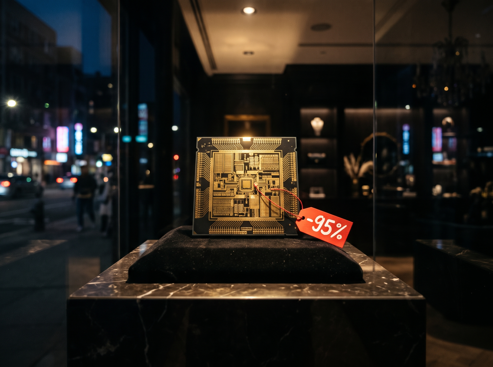

2026년 10월 17일, 중국의 DeepSeek이 DeepSeek-V4.1-Flash-1017을 공개했습니다. 가중치는 MIT 라이선스로 누구나 내려받아 쓸 수 있습니다. 모델카드에는 Anthropic의 Claude Opus 5를 여러 항목에서 앞선다는 표가 실렸습니다. 출시 직후 개발자 커뮤니티에서는 Opus 급 모델을 훨씬 싸게 쓸 수 있게 됐다는 기대와, 이제는 자기 서버에 직접 올려 쓸 수 있다는 기대가 함께 퍼졌습니다.

DeepSeek-V4.1-Flash-1017을 DS1017로 줄여 쓰겠습니다.

크기를 놓고 보면 이 주장은 더 눈길을 끕니다. DeepSeek이 발표한 DS1017의 크기는 5,520억 파라미터입니다. MoE 구조라서 토큰 하나를 처리할 때 실제로 계산에 쓰는 것은 그중 일부입니다. Opus 5의 크기는 Anthropic이 공개하지 않았습니다. 알려진 숫자는 일론 머스크(xAI 대표)가 올해 4월 X에 Claude Opus가 5조 파라미터라고 쓴 것 하나뿐입니다. Anthropic이 확인한 수치는 아닙니다. 이 주장이 맞다면 DS1017은 Opus의 10분의 1 남짓한 크기로 같은 자리를 노리는 셈입니다.

여기서 세 가지를 따져 보겠습니다. 첫째, DS1017은 정말 Opus 5만큼 일을 잘하는가? 둘째, 화웨이 MaaS 같은 퍼블릭 서비스로 쓰면 값이 얼마인가? 셋째, 100명이 동시에 각자 초당 50토큰씩 받도록 직접 구축하면 GPU를 빌릴 때와 서버를 살 때 각각 얼마가 드는가? 성능은 제가 직접 잰 결과와 독립 측정 기관의 결과로 비교했고, 직접 구축 비용은 서비스를 실제로 운영하는 쪽이 공개한 최적화 수치로 계산했습니다.

결론을 먼저 말씀드립니다. DS1017은 한 시간 안쪽의 코딩 작업에서 Opus 5와 같은 점수를 내고, 퍼블릭 서비스로 쓰면 값은 Opus 5의 20분의 1입니다. 100명이 함께 쓰는 규모라면 최적화된 엔진으로 B300 서버 한 대에 직접 올려 감당할 수 있다는 계산이 나옵니다. 그러나 그 서버가 퍼블릭 서비스나 구독보다 싸지는 것은 하루 종일 쉬지 않고 채워 쓸 때뿐이고, 그 구성을 실제로 재 본 사람은 아직 없습니다. Opus도 API 정가로는 비싸지만, Claude 정액 구독으로 쓰면 여전히 싸게 쓸 수 있습니다.

## 제 측정에서 DS1017과 Opus 5의 코딩 점수는 같았습니다

모델카드의 점수는 그대로 믿기 어렵습니다. 회사가 직접 잰 점수는 측정 조건이 저마다 다르고, 경쟁 모델의 점수를 어디서 가져왔는지도 잘 적혀 있지 않습니다. 그래서 같은 하네스와 같은 과제로 직접 쟀습니다. 하네스는 모델에 도구를 쥐여 주고 작업을 굴리는 실행 환경입니다. 같은 모델이라도 하네스가 다르면 점수가 달라집니다. 실제로 DeepSeek은 9월판의 장기 터미널 작업 점수를 자체 하네스로, DS1017의 점수를 Claude Code로 쟀습니다. 발표된 개선 폭에는 하네스 차이가 섞여 있습니다.

제 측정은 Claude Code를 각 모델에 연결해 실제 개발 과제를 맡기고, 모델이 볼 수 없는 숨김 테스트로 자동 채점하는 방식이었습니다. 과제는 세 묶음입니다. 동시성 버그, SQL 엔진과 정규식 엔진 구현, 실제 오픈소스 이슈 수정 같은 어려운 코딩 과제가 가장 많고, 빈 폴더와 명세서만 주고 백엔드나 인터프리터를 처음부터 만드는 프로젝트, 바이너리와 통신 프로토콜을 분석해 호환 구현을 만드는 리버스 엔지니어링 과제가 있습니다. 과제마다 세 번씩 돌렸습니다. DS1017은 화웨이 클라우드의 MaaS로, Opus 5는 Anthropic API로 돌렸고, 생각 모드와 effort는 Claude Code 기본값으로 맞췄습니다. 결과는 아래 표 위쪽 세 줄과 같습니다.

| 항목                                   | DS1017        | Claude Opus 5      | 근거                        |
| ------------------------------------ | ------------- | ------------------ | ------------------------- |
| 26과제 × 3회 평균 점수                      | 99.3%         | 98.4%              | 직접 측정                     |
| 실행 1회 시간 (중앙값)                       | 397초          | 795초               | 직접 측정                     |
| 실행 1회 비용                             | 0.27달러        | 5.68달러 (API 정가 환산) | 직접 측정                     |
| Terminal-Bench 4.0 (장기 터미널 작업)       | 34            | 49                 | Artificial Analysis 독립 측정 |
| HLE (도구 없는 어려운 추론)                   | 43            | 55                 | Artificial Analysis 독립 측정 |
| AA-Omniscience (지식 정확도, 높을수록 환각이 적다) | 5             | 37                 | Artificial Analysis 독립 측정 |
| AutomationBench (업무 자동화)             | 67            | 57                 | Artificial Analysis 독립 측정 |

점수는 사실상 같았습니다. 차이는 과제 하나에서 갈렸습니다. 통신 프로토콜 리버스 엔지니어링 과제에서 Opus 5는 서버에 처음 인사하는 메시지의 버전 바이트, 명령마다 다른 응답 형식, 인증 토큰의 대소문자 처리 규칙을 잘못 추정했고, 한 번은 60분 제한을 넘겼습니다. 나머지 과제는 두 모델 모두 거의 만점이었습니다. 바이너리를 직접 들여다보며 가설을 세우고 고쳐 나가는 일에서는 DS1017이 더 적게 틀렸습니다. 과제 하나를 세 번 돌린 결과라 표본은 작지만, 프런티어 모델이 모든 과제에서 앞서지는 않는다는 사례입니다. 짧은 실제 작업을 시킨 별도 측정에서도 두 모델은 단 한 번을 빼고 똑같이 성공했습니다.

차이는 시간과 비용에서 났습니다. DS1017은 실행 한 번에 Opus 5의 절반 시간을 썼고, 비용은 20분의 1 남짓이었습니다. 짧은 작업에서는 차이가 더 커서, 응답을 기다리는 시간이 3분의 1 아래로 줄었습니다. 개발자가 에이전트에게 일을 맡기고 기다리는 시간이 그만큼 짧아진다는 뜻입니다.

일하는 모양도 달랐습니다. Opus 5는 도구를 덜 부르고 도구 오류도 절반 수준이었습니다. 계획을 세워 정확하게 움직이는 편입니다. 대신 끝난 작업을 다시 검증하는 데 시간을 썼습니다. 시간 초과의 대부분은 이미 만점을 받은 상태에서 검증을 이어 가다 제한을 넘긴 경우였습니다. DS1017은 일을 끝내면 바로 멈췄고, 시간 초과가 한 번도 없었습니다. 신중함은 Opus 5의 장점이지만, 한 시간 안에 끝나는 일에서는 그 신중함이 시간으로 청구됐습니다.

주의할 설정이 하나 있습니다. DS1017은 생각 모드를 끄면 어려운 과제 점수가 4분의 3 수준으로 떨어집니다. 일찍 "끝났다"고 판단하고 멈추기 때문입니다. 위의 동점은 생각 모드를 켠 상태의 결과입니다. 코딩 에이전트로 쓸 때는 생각 모드를 반드시 켜 두고, 짧은 요약이나 분류처럼 답이 분명한 일에만 꺼서 속도를 얻는 편이 맞습니다.

## DS1017은 토큰마다 계산하는 양이 적어서 쌉니다

DS1017이 같은 점수를 싸게 내는 첫 번째 이유는 크기에 있습니다. 5,520억 파라미터는 공개 모델 가운데서도 작은 편이 아니지만, 토큰마다 계산에 쓰는 양은 훨씬 적습니다. DS1017의 전문가는 384개이고, 토큰 하나가 지나갈 때 그중 6개와 공유 전문가 1개만 깨어납니다. DeepSeek의 설명으로는 출력 토큰 하나를 만들 때 계산에 참여하는 파라미터가 전체의 30분의 1가량이고, 입력을 읽을 때는 그 절반입니다. 전문가 가중치는 4비트, 나머지는 8비트로 배포됩니다. 계산량과 메모리를 한꺼번에 줄인 설계입니다.

여기에 Engram이라는 별도의 조회 표가 붙습니다. 자주 나오는 n-gram을 표에 담아 두고 토큰마다 한 줄씩만 읽는 장치입니다. 커뮤니티 분석에 따르면 이 표를 합친 체크포인트 전체는 공식 크기보다 3분의 1 넘게 큽니다. 토큰마다 한 줄만 읽으므로 GPU 밖의 메모리에 둘 수 있습니다. 공식 크기에 이 표를 넣지 않은 것도 그래서입니다.

머스크의 주장대로 Opus가 5조 파라미터라면, DS1017은 그 10분의 1 남짓한 크기로 한 시간 안쪽의 코딩 과제에서 같은 점수를 냈습니다. 토큰마다 계산하는 양으로 따지면 격차는 더 클 것으로 보입니다. Opus의 구조가 공개되지 않아 정확히 비교할 수는 없지만, 같은 일을 훨씬 적은 계산으로 해낸다는 점이 값이 싼 구조적인 이유입니다. 9월판에서 DS1017로 오는 5주 사이에도 점수는 그대로인데 제 과제의 실행 시간은 절반 아래로, 비용은 3분의 2 수준으로 줄었습니다. 같은 일을 더 짧은 출력으로 끝내게 된 덕분입니다.

## 독립 측정의 종합 성능에서는 Opus 5가 앞섭니다

그렇다면 DS1017이 Opus 5보다 낫다는 말은 맞을까요? 모델카드가 Opus 5를 앞선다고 적은 항목은 열한 개 중 네 개입니다. 실제 코딩, 업무 자동화, 그리고 공개된 지 얼마 안 된 에이전트 벤치마크 두 개입니다. 이 가운데 Anthropic이 직접 낸 점수와 맞대 볼 수 있는 항목은 두 개뿐입니다.

실제 코딩 벤치마크인 DeepSWE에서는 주장이 성립합니다. DS1017의 점수는 Anthropic이 직접 발표한 Opus 5의 점수보다 높고, DeepSeek이 표에 적은 Opus 5 점수와 비교해도 앞섭니다. 제 측정에서 코딩 과제가 동점으로 나온 것과도 어긋나지 않습니다.

업무 자동화 벤치마크인 AutomationBench에서는 성립하지 않습니다. DeepSeek 모델카드가 적은 Opus 5의 점수는 Anthropic과 벤치마크를 운영하는 Zapier가 공개한 점수의 두 배 가까이 됩니다. 같은 모델의 같은 벤치마크 점수가 이만큼 다른데, DeepSeek은 어떤 문항과 조건으로 쟀는지 밝히지 않았습니다. DS1017 자신의 점수도 Zapier의 비공개 문항으로 잰 값이 아니고 DeepSeek이 직접 잰 값입니다. 숫자만 보면 DS1017이 이기지만, 같은 조건에서 비교했다는 근거는 없습니다.

독립 측정 기관 Artificial Analysis의 결과는 더 냉정합니다. 표 아래쪽 네 줄이 그 값입니다. 몇 시간씩 이어지는 터미널 작업과 도구 없는 어려운 추론에서는 Opus 5가 크게 앞섭니다. 모르는 사실을 지어내지 않는 능력은 격차가 가장 큽니다. DS1017이 앞선 것은 업무 자동화와 긴 문서 이해 쪽입니다. 사람들이 두 모델의 웹 개발 결과물을 나란히 놓고 고르는 LMArena WebDev 순위에서도 Opus 5가 위에 있고, 종합 지수도 Opus 5가 앞섭니다. 독립 측정에서 DS1017의 장기 터미널 작업 점수는 DeepSeek이 스스로 발표한 점수보다 꽤 낮았고, 또 다른 독립 측정 기관 Vals.ai의 결과도 비슷했습니다.

독립 측정이 DS1017에 유리하게 확인해 준 것도 있습니다. 값과 속도입니다. Artificial Analysis가 종합 지수를 재는 데 든 비용은 DS1017이 Opus 5의 약 22분의 1이었습니다. 제가 잰 비율과 거의 같습니다. 생성 속도는 DS1017이 세 배가량 빨랐습니다. DS1017은 같은 지수를 재는 데 출력 토큰을 Opus 5보다 1.5배쯤 더 썼지만, 단가 차이가 그보다 훨씬 커서 값의 격차는 줄지 않았습니다. 성능은 누가 재느냐에 따라 결론이 갈렸지만, 값과 속도는 누가 재도 결론이 같았습니다.

Anthropic의 현재 최상위 모델인 Opus 5.5와 비교하면 차이가 더 분명해집니다. DeepSeek이 발표한 점수로 보더라도 DS1017의 장기 터미널 작업과 어려운 추론 점수는 Opus 5.5의 3분의 2 수준입니다. 9월판이 절반 남짓이었던 데 비하면 격차는 줄었지만 아직 뚜렷합니다.

제 측정에도 한계가 있습니다. 과제를 60분 안에 끝나도록 만들었고, 두 모델 모두 거의 만점을 받았습니다. 시험지가 쉬우면 실력 차이가 드러나지 않습니다. 공개 점수에서 격차가 큰 장기 작업과 어려운 추론은 제가 재지 못한 영역입니다. 그래서 정확한 판정은 이렇습니다. DS1017이 Opus 5보다 낫다는 말은 실제 코딩과 일부 업무 자동화에서만 맞고, 종합으로는 Opus 5가 앞섭니다. 확실히 성립하는 말은 따로 있습니다. 한 시간 안쪽의 코딩 작업에서 DS1017은 Opus 5와 같은 결과를 절반의 시간에 냅니다. 출시 직후 개발자 커뮤니티의 반응도 대체로 이쪽이었습니다. Opus보다 낫다는 평가보다, 거의 같은 품질을 훨씬 싸게 쓴다는 평가가 많았습니다.

## 화웨이 MaaS로 쓰면 값은 Opus 5의 20분의 1입니다

이제 값을 따져 보겠습니다. 기준은 하나로 정해 보았습니다. 100명이 동시에, 각자 초당 50토큰씩 답을 받는 상황입니다. 초당 50토큰이면 코드와 설명이 사람이 읽는 속도보다 빠르게 나옵니다. 100명을 합치면 초당 5,000토큰의 출력입니다. 이 부하를 퍼블릭 서비스와 직접 구축에 똑같이 걸어 봅니다.

화웨이 MaaS는 DS1017을 출력 100만 토큰당 1.2달러에 팝니다. Opus 5 API 정가의 20분의 1이고, 입력 단가도 같은 비율입니다. 이미 캐시에 남아 있는 입력은 다시 그 10분의 1입니다.

코딩 에이전트는 출력만 쓰지 않습니다. 한 번 답할 때마다 지금까지의 대화, 열어 본 파일, 도구 실행 결과를 입력으로 다시 보냅니다. 그 입력의 대부분은 직전 요청과 겹쳐서 캐시 단가로 계산됩니다. 입력이 출력의 몇 배인지는 작업마다 크게 다르기 때문에 두 가지 경우로 나눠 계산했습니다. 하나는 제 측정에서 실제로 든 비용을 출력 토큰 수로 나눈 값입니다. 한 시간 안쪽의 과제를 푸는 동안 입력과 캐시 비용이 출력 한 토큰마다 얼마씩 붙었는지가 그대로 들어 있습니다. 다른 하나는 여러 에이전트가 큰 코드베이스를 계속 다시 읽는 경우입니다. 뒤에서 다룰 한 기업의 운영 사례에서는 새 출력 한 토큰마다 입력이 약 1,000토큰씩 들어갔습니다. 어느 쪽으로 계산해도 DS1017과 Opus 5의 값 차이는 20분의 1 안팎으로 유지됩니다. 입력이 많은 경우에는 두 서비스 모두 값이 몇 배로 뛰지만, 캐시 할인이 같은 비율로 붙기 때문입니다.

퍼블릭에도 걸리는 조건이 있습니다. 화웨이 MaaS의 DS1017에는 분당 요청 100건의 기본 한도가 있습니다. 제 측정에서 Claude Code는 실행 한 번에 도구를 약 50번 불렀고, 실행 하나는 6~7분 걸렸습니다. 세션 하나가 분당 7~8건의 요청을 보내는 셈입니다. 네 세션을 동시에 돌린 제 측정에서는 한도에 거의 걸리지 않았지만, 100명이 동시에 에이전트를 돌리면 분당 수백 건이 되어 기본 한도를 크게 넘습니다. 100명 규모로 쓰려면 한도 상향을 먼저 협의해야 합니다. 퍼블릭의 값은 싸지만, 그 값으로 쓸 수 있는 양은 공급자가 정합니다.

퍼블릭 단가가 이렇게 낮은 데는 운영 규모도 한몫합니다. DeepSeek은 10월 19일 실제 서비스에 쓰는 추론 엔진 DeepInfer를 공개하며 운영 수치를 함께 밝혔습니다. 효율이 제대로 나오는 기준 구성은 프리필 GPU 64장과 디코드 GPU 64장입니다. 이 회사의 서비스는 하루 155조 토큰을 처리하고, GPU 한 장이 시간당 38달러어치의 토큰을 팝니다. 수많은 사용자의 요청을 한데 모아 GPU를 쉬지 않고 돌릴 때 나오는 효율입니다. 화웨이도 같은 방향에 있습니다. DS1017은 화웨이 칩 Ascend에 맞춰 최적화됐고, DeepSeek은 Ascend 16만 개를 운영에 쓰고 있습니다.

## GPU를 빌려 직접 구축하면 B300 8장 서버 한 대가 필요합니다

가중치가 공개돼 있으니 직접 올리면 어떨까요? 직접 구축은 두 갈래로 나눠 봐야 합니다. Runpod 같은 클라우드에서 GPU를 시간 단위로 빌리는 길과, 서버를 사서 회사 안에 두는 길입니다. 어느 쪽이든 먼저 정해야 할 것은 기준 부하에 GPU가 몇 장 필요한가입니다.

시작점은 메모리입니다. 원본 형식의 DS1017은 Engram 표를 GPU 밖에 두어도 엔비디아 B300 한 장에 다 들어가지 않습니다. 그래서 B300은 2장, H200이라면 4장이 최소입니다. 아무리 작게 시작해도 B300 2장짜리 노드 하나가 출발점입니다.

다음은 엔진입니다. 여러 사람을 받는 서비스에는 SGLang 같은 서비스용 엔진을 씁니다. LMSYS가 10월 24일 공개한 결과를 보면, SGLang은 DeepInfer의 자체 벤치마크로 같은 하드웨어에서 비교했을 때 프리필과 디코드 모두 DeepSeek 엔진과 같거나 조금 나은 수준이었습니다. DeepSeek 내부의 최적화를 공개 엔진으로도 거의 그대로 얻을 수 있다는 뜻입니다. 공식으로 지원하는 장비는 GB300, B300, B200, H200, MI355X입니다. 많은 회사가 가진 H100은 목록에 없습니다.

이제 처리량을 보겠습니다. 기준 부하에 필요한 GPU 수는 아래 표처럼 계산했습니다. 출발점은 DeepSeek이 DeepInfer와 함께 공개한 디코드·프리필 처리량입니다. 표의 GPU 수는 이 공개 수치로 계산한 추정이고, 제가 측정한 값이 아닙니다.

| 항목 | 값 | 근거 |
|---|---|---|
| 기준 부하 출력 | 초당 5,000토큰 | 100명 × 사람당 초당 50토큰 |
| 디코드 처리량 (최적화 엔진) | GPU당 초당 약 14,500토큰 (실서비스 운영점) | DeepSeek DeepInfer, B300급 64장 구성 |
| 프리필 처리량 | GPU당 캐시 안 된 입력 초당 6만~8.9만 토큰 | DeepSeek DeepInfer, B300급 4장 구성 |
| 에이전트의 캐시 안 된 입력 | 출력의 약 36배 → 초당 약 18만 토큰 | Tom's Hardware 운영 사례의 비율 |
| GPU 메모리 최소 단위 | 약 310GB → B300 2장 또는 H200 4장 | 모델 구조 (Engram은 GPU 밖) |
| 필요한 GPU (추정) | 에이전트: B300 8장 서버 1대 / 채팅: B300 2~4장 | 디코드 + 프리필 + 여유 |
| 서버 구매가 | B300 8장 서버 1대 약 10억 원 | 국내 도입가 기준. 관세·유통·구성 옵션 포함 |
| 구매 총액 (추정) | 이중화 2대 장비만 약 20억 원 | 저장소·네트워크·전력·설치를 더하면 20억 원 이상 |

계산에서 눈여겨볼 것은 병목의 위치입니다. 디코드는 문제가 되지 않습니다. 100명이 받을 출력 전체가 DeepSeek 운영점에서 GPU 한 장이 내는 양에도 못 미칩니다. DeepSeek의 수치는 64장 클러스터에서 나왔고, MoE는 GPU가 적을수록 전문가 하나에 모이는 토큰이 줄어 효율이 떨어집니다. 그래도 여유가 워낙 커서, 8장 서버에서 효율이 몇 분의 1로 떨어지더라도 디코드는 충분합니다.

진짜 병목은 프리필입니다. 코딩 에이전트는 턴마다 대화와 파일을 다시 보내고, 그중 캐시에 없는 부분은 새로 읽어야 합니다. 운영 사례의 비율을 쓰면 캐시 안 된 입력만 해도 출력의 수십 배이고, 이를 읽는 데 B300 두세 장이 듭니다. 캐시에 남은 입력은 그보다 훨씬 많아서, KV 캐시를 얼마나 잘 재사용하고 저장소가 얼마나 빠른지에 따라 필요한 장비가 달라집니다. DeepSeek은 GPU마다 큰 SSD 저장소를 붙여 캐시를 사흘간 보존합니다. 디코드와 프리필, 캐시 처리에 여유를 더하면 에이전트 부하에는 B300 8장 서버 한 대가 현실적인 규모로 보입니다. 입력이 짧은 채팅이라면 2~4장으로도 됩니다.

임대 비용을 한 달 값으로 환산한 결과는 뒤의 월간 비교표에 모았습니다. Runpod의 10월 시세로 B300 8장을 빌리면 업무 시간만 쓸 때는 구독료보다 싸고, 24시간 빌려 두면 구독료의 두세 배가 됩니다. 임대에는 시세 밖의 조건도 붙습니다. B300은 재고가 귀해서 제가 10월 말에 조회했을 때 2장 묶음조차 비어 있지 않았습니다. 업무 시간에만 빌리고 밤에 반납하는 방식은 매일 아침 장비를 다시 구할 수 있어야 성립합니다. 임대료는 오르는 중이기도 합니다. 9월에는 H100 임대료가 한 달 사이 22% 올랐다는 보도가 나왔습니다.

실제로 빌려서 운영해 본 사례가 있습니다. Tom's Hardware가 10월 1일 보도한 콜센터 컨설팅 회사 The Call Center Doctors는 Claude Code 에이전트용으로 H200 4장 서버를 빌려 DeepSeek V4.1 Flash 9월판을 서빙했습니다. 한 달 임대료는 같은 달 Claude Code 구독료의 두 배가 넘었습니다. 에이전트 입력의 대부분이 이미 읽은 문맥을 다시 보내는 것이었고, 서버는 그 재읽기에 바빠 새 토큰을 쓸 시간이 적었습니다. 모델을 안정적으로 띄우는 데만 다섯 번을 시도했고, 보안 문제로 코드를 쓰는 일은 맡기지 못한 채 읽기 전용 리뷰 에이전트로만 운영했습니다. 같은 기간의 토큰을 Opus 5.5 정가로 치면 구독료의 25배였다고 합니다. API 정가로 따지면 DeepSeek이 20분의 1 값이지만, 정액 구독과 비교하면 그 차이는 사라졌습니다. 구독이 주는 정액 할인이 그만큼 크기 때문입니다.

제가 직접 올려 본 경험도 같은 방향입니다. B300 한 장에 llama.cpp로 DS1017을 올려 보았습니다. 원본 형식은 한 장에 들어가지 않아 커뮤니티가 더 압축해 내놓은 형식을 썼습니다. 혼자 쓸 때는 충분히 빨랐지만 사람이 늘자 사람당 속도가 금세 떨어졌습니다. 서비스에 쓰려면 최적화가 더 필요한 구성이지만, 결과는 앞에서 본 수치의 흐름과 일치했습니다.

## 서버를 사면 이중화까지 20억 원이 넘게 듭니다

서버를 사는 쪽은 계산이 달라집니다. B300 8장이 든 서버 한 대는 국내 도입가로 약 10억 원으로 잡았습니다. 한 대가 멈추면 서비스 전체가 멈추니 이중화를 하려면 두 대가 필요하고, 그러면 장비값만 약 20억 원입니다.

서버만 사서는 돌아가지 않습니다. KV 캐시를 담을 SSD 저장소 서버, 노드 사이를 잇는 400Gbps급 네트워크, 서버 한 대에 10kW가 넘는 전력과 냉각, 상면과 설치가 필요합니다. 이를 더하면 이중화한 구성은 20억 원을 넘습니다. 이중화 없이 한 대로 시작해도 장비값만 10억 원입니다.

장비 수명을 3년으로 잡고 나누면 한 달 값이 나옵니다. 이중화한 두 대를 사서 3년 내내 상시로 쓰면, 장비값은 B300 8장 한 대를 24시간 빌려 두는 값과 비슷하거나 조금 싼 정도입니다. 이중화 없이 한 대라면 그 절반입니다. 다만 이 비교는 장비를 3년 내내 꽉 채워 쓸 때의 이야기이고, 업무 시간에만 쓴다면 임대가 유리합니다. 사용률이 낮으면 금방 역전되고, 운영 인력의 인건비는 아직 넣지 않았습니다. 엔진을 올리고, 버전을 맞추고, 장애에 대응하는 사람의 시간은 직접 구축 쪽에만 붙습니다.

이미 가진 장비로 해결하는 길도 좁습니다. 많은 회사가 들여 놓은 H100은 SGLang의 공식 지원 목록에 없어서, 원본 DS1017이 제대로 돈다는 보장이 없습니다. 화웨이 칩으로 구축하는 길은 사실상 닫혀 있습니다. 국내에서 Ascend 950을 살 경로가 거의 없고, 화웨이가 9월 말 공개한 저장소 여섯 개 가운데 10월 21일 기준으로 바로 쓸 수 있는 것은 하나였습니다. 화웨이 칩 위의 DS1017은 화웨이가 운영하는 MaaS로 쓰는 것이 현실적인 길입니다.

## 한 달 비용은 장비를 얼마나 채워 쓰느냐로 갈립니다

지금까지는 API와 직접 구축을 따로 셌습니다. 실제로 많은 개발자가 Opus를 쓰는 방법은 따로 있습니다. 정액 구독입니다. Claude Max 20x 플랜은 한 사람에 월 200달러이고, 100명이면 월 2만 달러입니다. 구독은 값을 달 단위로 매기므로 비교도 달로 맞춥니다. 가동 시간은 두 가지로 가정했습니다. 하루 8시간씩 월 22일 일하는 업무 시간 176시간과, 하루 24시간씩 30일 내내 도는 상시 720시간입니다. 종량 값은 기준 부하가 그 시간 내내 걸린다고 본 값이고, 임대 값은 그 시간만큼 장비를 빌린다고 본 값입니다.

구독은 성격이 다릅니다. 값은 정해져 있지만 쓸 수 있는 양에 한도가 있습니다. 100명이 각자 초당 50토큰을 하루 종일 받는 부하를 구독이 보장하지는 않습니다. 대신 사람이 Claude Code로 일하는 실제 모습은 그 부하와 거리가 멉니다. 일을 맡기고, 결과를 읽고, 다음 일을 생각하는 사이에 모델은 쉽니다. 이렇게 띄엄띄엄 쓰는 패턴에서는 Claude 구독 가격이 여전히 쌉니다. Opus 급 모델을 쓰는 가장 싼 방법이 구독입니다. 제 측정이 그 근거입니다. 이번 비교에서 Opus 5는 구독 인증으로 돌렸는데, API 정가로 치면 한 사람의 한 달 구독료의 두 배가 넘는 양을 하루에 썼지만 추가 청구도 없었고 한도에도 걸리지 않았습니다. 다만 세 세션을 하루 돌린 결과라, 100명이 매일 같은 양을 써도 괜찮다는 근거는 되지 못합니다. 한도 정책은 공급자가 언제든 바꿀 수 있습니다.

데이터도 따져야 합니다. 구독으로 쓰는 Opus도 요청과 코드가 Anthropic의 클라우드로 나갑니다. MaaS의 DS1017은 홍콩 리전을 거칩니다. 데이터를 회사 밖으로 내보낼 수 없다면 구독도 퍼블릭 API도 선택지에 들지 못합니다.

모든 방식을 한 표에 모으면 다음과 같습니다. 구독과 구매를 뺀 모든 줄은 100명이 각자 초당 50토큰을 받는 기준 부하의 한 달 값입니다.

| 방식                                | 업무 시간 (월 176시간)    | 상시 (월 720시간)   | 조건과 근거                                                 |
| --------------------------------- | ------------------ | -------------- | ------------------------------------------------------ |
| 화웨이 MaaS DS1017, 출력만              | 약 3,800달러          | 약 1.6만 달러      | 공식 단가. 100명을 받으려면 기본 요청 한도 상향 필요                       |
| 화웨이 MaaS DS1017, 에이전트 (제 측정 비율)   | 약 1.6만 달러          | 약 6.4만 달러      | 공식 단가 × 제 78회 실행의 실제 입출력 비용                            |
| 화웨이 MaaS DS1017, 에이전트 (입력이 많은 경우) | 약 12.8만 달러         | 약 52만 달러       | 출력 1토큰당 캐시 안 된 입력 36, 캐시 입력 950 (Tom's Hardware 사례 비율) |
| Opus 5 API, 에이전트 (제 측정 비율)        | 약 31만 달러           | 약 127만 달러      | 공식 정가 × 제 측정 비율. 입력이 많은 경우는 그 7배                       |
| Claude Max 20x 구독 100명            | 2만 달러              | 2만 달러          | 정액. 사용량 한도가 있어 기준 부하 보장 없음. 데이터 외부 전송                  |
| 임대, B300 8장 (에이전트 추정 구성)          | 약 9,800~1.27만 달러   | 약 4만~5.2만 달러   | Runpod 10월 시세. GPU 수는 공개 수치로 계산한 추정                    |
| 임대, B300 2장 (최소 단위, 채팅용)          | 약 2,400~3,200달러    | 약 1만~1.3만 달러   | 입력이 짧은 채팅에 한정                                          |
| 임대, H200 4장 (운영 사례 구성)            | 약 3,200~3,700달러    | 약 1.3만~1.5만 달러 | 운영 사례는 에이전트 48~64개 읽기 전용으로 재읽기 병목                      |
| 구매, B300 8장 서버 1대                 | 약 2만 달러 (2,800만 원) | 약 2만 달러        | 약 10억 원을 3년으로 나눈 장비값. 전력·인력 제외                         |
| 구매, 서버 2대 (이중화)                   | 약 4만 달러 (5,600만 원) | 약 4만 달러        | 장비 약 20억 원을 3년으로 나눈 값. 저장소·네트워크·전력·인력 제외               |

달러와 원은 1달러 약 1,400원으로 환산했습니다. 입력이 많은 경우의 비율은 DeepSeek 계열 모델을 읽기 전용 에이전트로 운영한 한 회사의 수치라서, 작업에 따라 이보다 적을 수도 많을 수도 있습니다.

이 비교에서 알 수 있는 것은 세 가지입니다. 첫째, 입력이 적은 작업이면 퍼블릭 DS1017이 가장 단순하고 싼 길입니다. 업무 시간 기준으로는 에이전트 사용까지 넣어도 구독료보다 낮습니다. 둘째, 입력이 많은 에이전트 작업을 하루 종일 돌리면 순서가 뒤집힙니다. 퍼블릭은 입력 요금이 쌓여 값이 몇 배로 뛰지만, 직접 구축은 장비값이 고정이라 같은 부하를 훨씬 싸게 받습니다. 상시 부하라면 서버를 사는 쪽이 빌리는 쪽보다 쌉니다. 셋째, 직접 구축이 이기는 경우는 모두 장비를 쉬지 않고 채운다는 가정 위에 서 있습니다. 사람이 띄엄띄엄 쓰면 퍼블릭은 쓴 만큼만 받고 구독은 정액에 머물지만, 빌리거나 산 장비는 쉬는 시간에도 값을 받습니다. 운영 사례의 회사가 구독료의 두 배를 낸 것도 이 때문입니다.

같은 DS1017이라도 한 달 값은 모델보다 장비를 얼마나 빈틈없이 채워 쓰느냐가 정합니다. 같은 표에서 Opus API 정가 줄과 구독 줄을 나란히 놓으면, Claude 구독 가격이 여전히 싸다는 것도 분명해집니다. 구독은 그 빈틈을 공급자가 대신 메워 주고 정액으로 파는 방식이고, 직접 구축은 그 빈틈을 스스로 메워야 하는 방식입니다.

## 에어갭 환경이라면 직접 구축밖에 길이 없습니다

값만 보면 직접 구축은 부하가 크고 꾸준한 회사에만 맞습니다. 그래도 값과 상관없이 직접 올려야 하는 곳이 있습니다. 데이터가 회사 밖으로 조금도 나가면 안 되는 곳입니다. 금융회사의 고객 거래 데이터, 국방 분야의 기밀, 병원의 환자 기록, 보안 감사를 받는 시스템의 소스 코드가 그렇습니다. 이런 곳은 업무망을 외부 인터넷과 물리적으로 끊어 둔 에어갭(air-gap) 환경에서 일해야 하는 경우가 있습니다.

에어갭 안에서는 퍼블릭 API도 구독도 처음부터 선택지가 되지 못합니다. 화웨이 MaaS의 DS1017은 홍콩 리전을 거치고, 구독으로 쓰는 Opus도 요청과 코드가 Anthropic의 클라우드로 나갑니다. 클라우드에서 GPU를 빌리는 것도 외부 데이터센터를 쓰는 일이라 맞지 않습니다. 남는 길은 가중치를 안으로 들여와 직접 산 서버에서 돌리는 것뿐입니다. 가중치를 내려받을 수 없는 모델은 이런 환경에 들이기 어렵고, MIT 라이선스로 공개된 DS1017은 들일 수 있습니다. 프런티어급 코딩 성능을 에어갭 안에서 쓸 수 있는 길이 생긴 것입니다.

이런 곳에서는 직접 구축 비용을 퍼블릭과 견줄 필요가 없습니다. 앞의 월간 비교표에서 퍼블릭과 구독, 임대 줄이 모두 지워지고 구매 줄만 남기 때문입니다. 서버 한 대 값과 이중화 비용은 이 성능을 안에서 쓰기 위해 치러야 하는 값 그 자체입니다. 앞에서 계산한 구매 비용이 가장 직접적인 의미를 갖는 곳이 여기입니다. 유효 기간이 짧다는 점은 부담으로 남습니다. 새 버전이 나올 때마다 가중치를 검증해 안으로 들여오는 절차를 거쳐야 합니다.

직접 구축을 고른다면 장비를 사기 전에 재야 할 것이 분명합니다. 앞의 GPU 수는 공개 수치로 계산한 추정이라, 실제 회사의 작업에서 그대로 나온다는 보장이 없습니다. 먼저 B300 2장이나 8장을 짧게 빌려 SGLang으로 원본을 올리고, 회사의 실제 에이전트 작업을 걸어 봐야 합니다. 볼 것은 세 가지입니다. 긴 입력을 가진 요청을 동시에 몇 개까지 받으면서 사람당 초당 50토큰을 지키는지, 그때 첫 글자가 나오기까지 몇 초가 걸리는지, 그리고 캐시 적중률이 얼마인지입니다. 이 숫자가 서버 대수를 정하고, 서버 대수가 한 달 값을 정하게 됩니다.

## 일상 코딩은 DS1017, 장기 작업은 Opus 5.5

정리하면 쓰임새가 갈립니다. 한 시간 안쪽의 일상적인 코딩 에이전트 작업은 퍼블릭 DS1017로 옮길 만합니다. 점수는 Opus 5와 같고, 시간은 절반, 값은 20분의 1입니다. 몇 시간씩 이어지는 자율 작업과 사실 정확도가 중요한 작업은 Opus 5.5에 남겨 두는 것이 맞습니다. 독립 측정의 격차가 그 영역에 몰려 있습니다. Opus를 계속 쓸 사람에게는 구독이 맞습니다. API 정가는 비싸지만 Claude 구독 가격은 여전히 쌉니다. 직접 구축은 에어갭처럼 데이터가 밖으로 나갈 수 없거나, 입력이 많은 에이전트 부하가 하루 종일 꾸준할 때 고릅니다. 결국 방식을 고를 때 따질 것은 네 가지입니다. 한 달에 드는 값, 쓸 수 있는 양의 상한과 보장, 데이터가 머무는 곳, 그리고 모델의 품질입니다.

옮기는 비용은 크지 않습니다. 화웨이 MaaS는 Anthropic API와 같은 형식의 접속 주소를 제공합니다. 저도 Claude Code의 설정에서 접속 주소와 모델 이름만 바꿔 DS1017을 연결했습니다. 개발자가 쓰던 하네스와 작업 방식은 그대로 두고, 작업의 성격에 따라 뒤에서 도는 모델만 고르면 됩니다. 짧은 기능 구현과 버그 수정은 DS1017로 보내고, 몇 시간짜리 자율 작업이나 틀리면 안 되는 분석은 Opus 5.5로 보내는 식입니다. 이때 DS1017의 생각 모드는 켜 두고, 데이터가 홍콩 리전을 거쳐도 되는 작업인지를 먼저 가르는 규칙이 함께 있어야 합니다.

이 판단의 유효 기간은 짧습니다. 9월판에서 DS1017까지 5주가 걸렸고, 그사이 같은 과제의 실행 시간이 절반 아래로 줄었습니다. 다른 프런티어 랩도 가만히 있지 않습니다. Anthropic은 9월 22일 Opus 5.5를 내놓았고, 공개 점수의 격차는 그 모델 기준으로 다시 벌어졌습니다. 그래서 표의 숫자보다 오래 남겨야 할 것은 재는 방법입니다. 자기 회사의 과제를 같은 하네스에 걸고, 모델이 볼 수 없는 테스트로 채점하고, 실행 한 번의 시간과 값을 함께 기록합니다. 새 모델이 나올 때마다 이 측정을 다시 돌리면 모델카드의 표를 믿을지 말지 고민할 필요가 없습니다.

처음의 질문은 DS1017이 Opus 5와 비슷한 성능을 내는가였습니다. 20분의 1 가격에 비슷한 성능을 낸다면 당연히 더 싼 모델을 쓰게 될 겁니다. 하지만 그렇게 간단하지는 않습니다. 비싼 것은 API 정가이고, 정액 구독으로 쓰면 Anthropic도 밀리지 않습니다. 서비스 회사 입장에서는 최고 수준의 지능을 갖춘 에이전트를 싸게 구축할 방법이 생겼습니다. 하지만 개발자가 Opus 급 모델을 쓰는 값으로 따지면, Claude 구독 가격은 여전히 쌉니다. API 정가는 비싸도 정액 구독으로 쓰면 Opus 급을 싸게 쓸 수 있고, 그 가격은 중국 랩들의 공개 모델과 견주어도 밀리지 않습니다.

## 참고 자료

- [DeepSeek-V4.1-Flash-1017 모델카드 (Hugging Face)](https://huggingface.co/deepseek-ai/DeepSeek-V4.1-Flash-1017)
- [DeepSeek DeepInfer (README 벤치마크, 배포 Q&A)](https://github.com/deepseek-ai/DeepInfer)
- [Kingy.ai: DeepInfer, DeepSeek's inference engine](https://kingy.ai/blog/deepinfer-deepseek-inference-engine/)
- [LMSYS: SGLang의 DS1017 지원과 DeepInfer 비교 (2026-10-24)](https://www.lmsys.org/blog/2026-10-24-dsv41-deepinfer/)
- [Tom's Hardware: H200 4장을 빌려 DeepSeek을 시험한 회사 (2026-10-01)](https://www.tomshardware.com/tech-industry/artificial-intelligence/firm-rents-four-nvidia-h200s-to-test-80x-cheaper-deepseek-claim-usd13-200-monthly-gpu-rental-doubles-claude-bill-while-security-flaws-keep-code-offline)
- [NextBigFuture: Anthropic과 xAI 모델 파라미터 수 (머스크 주장, 2026-04)](https://www.nextbigfuture.com/2026/04/anthropic-and-xai-model-parameter-counts.html)
- [Artificial Analysis: DeepSeek 1017 vs Claude Opus 5](https://artificialanalysis.ai/models/comparisons/deepseek-v4-1-flash-1017-vs-claude-opus-5)
- [Anthropic: Claude Opus (AutomationBench 각주)](https://www.anthropic.com/claude/opus)
- [Huawei Cloud MaaS 가격](https://support.huaweicloud.com/intl/en-us/price-maas/price-maas-0002.html)
