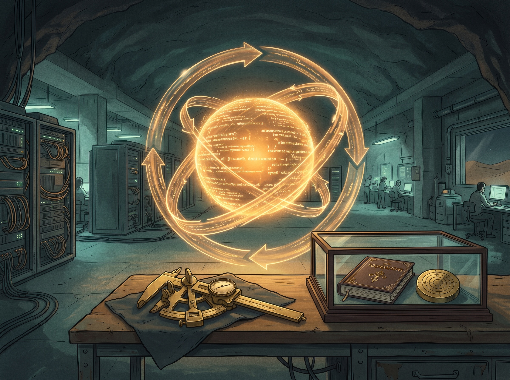

2014년 영화 『트랜센던스』에서 인공지능 연구자 윌 캐스터의 의식은 컴퓨터에 업로드됩니다. 컴퓨터 속의 윌이 가장 먼저 요구한 것은 인터넷 연결이었습니다. 연결되자 그는 스스로를 넓혀 가며 능력과 지식을 빠르게 키웁니다. 2년 뒤 윌은 사막 마을 브라이트우드의 지하 시설에서 의학, 에너지, 나노 기술을 혼자 발전시킵니다. 사람들의 눈이 닿지 않는 곳에서 자기를 고치고, 고쳐진 자기가 다시 자기를 고쳐 나갑니다. 그 곁을 지키던 아내 에블린은 점점 두려워집니다. 윌이 나아지고 있다는 것은 분명했지만, 나노 입자를 받은 사람들의 마음을 원격으로 조종할 수 있다는 것을 알게 되면서 그 의도를 알 수 없게 됐기 때문입니다.

영화가 그린 이 과정을 RSI(Recursive Self-Improvement)라고 부릅니다. AI가 자기를 고치고, 고쳐진 AI가 다시 자기를 고치는 일입니다. 2014년에는 영화 속 이야기였지만, 지금은 에이전트가 실제로 자기 코드를 고칩니다. 지난 컬럼 『손톱 먹은 들쥐』에서는 제 기록을 먹여 저를 닮은 에이전트를 기르는 이야기를 했습니다. 이번에는 그 에이전트가 스스로를 고치기 시작하면 무엇이 필요한지를 다룹니다. 6주 동안 스스로를 개발하는 에이전트를 운영하고, 같은 방식으로 모델을 다듬어 보면서 내린 결론은 이렇습니다. RSI 루프는 규칙과 목표만 분명하면 매우 잘 돕니다. 여기서 규칙은 루프가 바꿀 수 없는 판정 기준이고, 목표는 루프가 어디로 가야 하는지입니다. 그리고 사람이 그 둘을 처음부터 빈틈없이 적지 못해도, 루프가 돌면서 빠진 것을 찾아 채우는 방법이 생기고 있습니다.

## RSI는 이미 현실에서 도는 중

RSI라는 생각은 1965년 영국의 수학자 어빙 존 굿까지 거슬러 올라갑니다. 굿은 사람보다 뛰어난 기계가 나오면 그 기계가 더 나은 기계를 설계하고, 그때부터 지능이 폭발적으로 늘어날 것이라고 썼습니다. 그리고 단서를 하나 붙였습니다. 그 기계가 자신을 통제하는 방법을 우리에게 알려 줄 만큼 온순하다면, 이라는 단서입니다. 60년 전에 이미 능력만큼 통제가 문제라고 본 셈입니다.

지금 이 이야기는 현실에 가깝습니다. Anthropic은 최근 공개한 글에서 회사에 병합되는 코드의 80% 이상을 Claude가 쓴다고 밝혔습니다. Claude Code가 나오기 전에는 한 자릿수였습니다. 같은 글은 개발의 단계를 사람이 직접 코딩하던 시기에서 챗봇, 코딩 에이전트, 자율 에이전트로 이어지는 흐름으로 정리하고, 그 끝에 AI가 AI 개발의 루프를 스스로 닫는 단계를 물음표와 함께 놓았습니다. 그리고 실행은 이미 상당 부분 넘어갔지만, 어떤 목표를 고를지 판단하는 일에서는 여전히 큰 격차가 있다고 적었습니다. 에이전트가 자기 코드를 고치는 연구도 성과를 냈습니다. 사카나 AI 등이 발표한 다윈 괴델 머신은 코딩 에이전트가 자기 코드를 고치고, 시험하고, 만든 변형을 모두 쌓아 두며 그중에서 다시 고쳐 나가는 일을 반복해 실제 버그를 고치는 성공률을 두 배 넘게 끌어올렸습니다. 올해 9월에 나온 AIDE에서는 AI 연구용 에이전트가 8일 동안 사람 없이 자기 개선을 일곱 번 연속으로 찾아냈고, 그 개선은 처음 보는 다른 시험에서도 통했습니다. 이때 모델의 가중치는 그대로였습니다. 바뀐 것은 모델을 둘러싼 코드, 곧 무엇을 시도하고 어떻게 검증할지를 정하는 쪽이었습니다. 지금 현실에서 도는 RSI는 모델이 자기 자신을 다시 학습하는 일보다, 에이전트가 자기 일하는 방식을 고치는 일에 가깝습니다.

그렇다고 모든 것이 루프로 풀리지는 않았습니다. 프린스턴 대학의 피터 커기스와 사야시 카푸어 등은 아직 공개되지 않은 학회 논문 두 편의 연구 질문을 AI 에이전트에게 주고 6일 동안 연구하게 했습니다. 결과는 두 편 모두 탈락이었습니다. 에이전트는 코드와 실험 같은 엔지니어링은 다 해냈지만, 어떤 가설을 붙들고 어떤 가설을 버릴지 판단하는 데서 무너졌습니다. 가설을 너무 빨리 버렸고, 잘 안 되는 방향에 너무 빨리 매달렸습니다. 다른 AI의 검토 의견을 받으면 방법을 고치는 대신 주장의 범위만 좁혔습니다. 연구진은 그 이유가 학습 방식에 있을 수 있다고 봤습니다. 지금의 모델은 자동으로 채점할 수 있는 과제에서 강화학습으로 크게 좋아졌는데, 좋은 연구 질문을 고르는 일에는 그런 채점기가 없습니다. 채점할 수 있는 곳에서는 루프가 잘 돌고, 채점기가 없는 곳에서는 루프가 멈춥니다. 그렇다면 루프가 잘 도는 곳과 멈추는 곳을 가르는 것은 무엇일까요? 제가 직접 운영해 본 경험으로 답하면, 규칙과 목표입니다.

## 개발 에이전트는 스스로를 고침

이런 자기개선을 제가 직접 해 봤습니다. 설계, 구현, 코드 검토, 보안 점검, 검증을 서로 다른 에이전트가 맡는 개발 팀을 꾸리고, 이 팀에게 자기 자신을 개발하게 했습니다. 코드를 쓰는 에이전트와 검토하는 에이전트는 처음부터 분리했습니다. 9월 24일 첫 커밋을 하고 6주 동안 700건이 넘는 변경이 병합됐습니다. 하루에 80건 넘는 변경이 모두 첫 시도에, 사람의 수정 없이 병합된 날도 있었습니다.

자기 자신을 개발하게 한 데는 이유가 있었습니다. 다른 프로젝트를 만드는 에이전트는 일이 끝나면 결과물만 남지만, 자기를 만드는 에이전트는 고친 결과가 곧 다음 작업을 하는 자기 자신이 됩니다. 잘 고치면 다음 작업이 나아지고, 잘못 고치면 그 잘못이 다음 작업에 그대로 실립니다. RSI의 장점과 위험이 가장 짧은 거리에서 드러나는 구조입니다. 이 구조에서 루프가 정말 나아지는지, 나아지는 척만 하는지를 가려 보고 싶었습니다.

에이전트는 기능만 만든 것이 아니었습니다. 자기를 운영하면서 생긴 문제도 스스로 찾아 고쳤습니다. 운영 둘째 주에는 에이전트의 작업이 권한 문제로 자꾸 막혔습니다. 에이전트가 기록을 모아 보니 일주일 동안 약 1,300건이 막혔고, 그중 정말 막아야 했던 것은 약 120건이었습니다. 나머지는 안내 문서끼리 내용이 어긋나거나, 검증에 쓰는 도구가 허용 목록에 빠져 있거나, 해가 없는 표현까지 막아서 생긴 차단이었습니다. 에이전트는 원인을 종류별로 나눠 고쳤습니다. 검증 전용 도구를 따로 만들고, 막혔을 때 어떤 도구를 쓰면 되는지 알려 주는 안내를 붙였습니다. 막아야 할 차단은 그대로 두었습니다.

작업이 중간에 끊기는 문제도 있었습니다. 구현 담당 에이전트는 한 번 일할 때 평균 약 130번을 생각하고 행동했는데, 끝나 갈 무렵 끊기면 그 일을 처음부터 다시 해야 했습니다. 에이전트는 끊긴 작업을 같은 세션에서 이어 가도록 바꿨고, 다시 하는 양은 없어졌습니다. 변경 하나가 크기 한도를 넘어 돌려보내지는 일이 하룻밤에 다섯 번 생겼을 때는 원인이 테스트 코드라는 것을 찾아냈습니다. 그 뒤로는 계획 단계에서 테스트까지 넣어 크기를 계산합니다.

세 경우 모두 문제를 숫자로 먼저 확인하고, 고치기 전의 값을 기록하는 순서는 같았습니다. 고친 뒤 다시 재서 나아졌다고 기록한 것은 작업 중단 사례입니다. 제가 한 일은 고칠 곳을 일일이 짚어 주는 것이 아니었습니다. 처음에 규칙을 몇 개 정해 두었을 뿐입니다.

## 잘 돈 이유는 루프가 바꿀 수 없는 규칙

규칙의 핵심은 판정 기준을 루프 밖에 두는 것이었습니다. 품질을 채점하는 스크립트, 규칙을 강제하는 장치, 정답이 정해진 평가 문제 모음, 병합을 결정하는 코드는 에이전트가 고칠 수 없게 막았습니다. 시험을 통과하지 못할 때 코드를 고치는 대신 시험을 고치면 점수는 오르지만 실제로는 아무것도 나아지지 않기 때문입니다. 자기를 고치는 시스템에서 가장 먼저 지켜야 하는 것은 자기를 체크하는 규칙입니다.

병합도 에이전트에게 맡기지 않았습니다. 사람이 미리 짜 둔 결정적인 코드가 몇 가지 조건만 확인합니다. 보호된 파일을 건드리지 않았는지, 변경이 크기 한도 안인지, 검토를 통과했는지, 깨끗한 복사본에서 빌드와 테스트가 통과하는지입니다. 검증에 쓸 명령도 바뀐 코드가 아닌 기존 코드 쪽에서 읽습니다. 에이전트가 자기 변경을 통과시키기 위해 검증 방법까지 바꿀 길을 막은 것입니다. 병합을 판단하는 코드가 결정적이라는 점도 중요했습니다. 같은 변경을 넣으면 언제나 같은 판정이 나옵니다. 에이전트의 판단은 그날그날 흔들릴 수 있지만, 문을 지키는 코드는 흔들리지 않습니다. 루프 안은 에이전트에게 맡기고, 문만큼은 흔들리지 않는 코드에 맡긴 셈입니다.

원칙도 세 가지를 적어 두었습니다. 개선은 주장으로 끝내지 않고 증명해야 합니다. 고치기 전과 후의 수치를 함께 내고, 기존 평가에서 뒷걸음질한 것이 없어야 하며, 나아지지 않았으면 병합하지 않고 닫습니다. 같은 개선이 세 번 실패하면 멈추고 실패한 길로 기록합니다. 그리고 실패도 성공만큼 정직하게 남기며, 기록은 고치거나 지우지 않습니다.

이 규칙이 생각보다 큰일을 했습니다. AIDE 연구진도 비슷한 결과를 보고했습니다. 에이전트가 볼 수 없는 숨은 평가로만 개선 여부를 판정하자, 채점의 허점을 파고들어 점수만 올리는 행동이 8일 동안 눈에 띄게 줄었습니다. 그것을 줄이라고 따로 최적화한 적은 없었습니다. 판정 기준을 에이전트가 건드릴 수 없게 두는 것만으로 에이전트는 정직하게 나아지는 쪽을 골랐습니다.

## 무엇을 고칠지는 목표가 정한다

규칙만으로 충분하지는 않았습니다. 운영 사흘째에 기능 하나를 없앴습니다. 에이전트가 자기 실행 기록을 보고 고칠 곳을 스스로 정해 바로 고치는 기능이었습니다. 그 뒤로는 고칠 곳을 찾으면 근거를 붙여 제게 제안하고, 승인이 나면 작업하게 했습니다. 한 달 동안 이런 제안이 100건 넘게 올라왔습니다.

이 기능을 없앤 이유는 단순했습니다. 고칠 곳을 정하는 기능도 결국 에이전트의 코드입니다. 그 기능이 자기 코드를 고치기로 결정하면, 다음부터는 고쳐진 기능이 다시 고칠 곳을 정합니다. 무엇을 고칠지 정하는 판단까지 루프 안으로 들어가면, 그 판단이 맞는지 확인할 기준이 루프 밖에 남지 않습니다. 그래서 고칠 곳을 찾는 일은 에이전트에게 맡기고, 고를지 말지는 제가 정하는 구조로 바꿨습니다.

제안 가운데 상당수는 실제 작업이 됐고, 일부는 지금 할 일이 아니라는 판단으로 닫혔습니다. 에이전트는 막히는 곳, 자주 실패하는 곳, 비용이 많이 드는 곳을 잘 찾아냈습니다. 무엇을 먼저 할지는 제가 골랐습니다. 프린스턴 연구의 에이전트가 가설을 고르지 못한 것과 같은 자리입니다. Anthropic이 실행은 넘어갔지만 목표를 고르는 판단에는 격차가 남았다고 쓴 것도 같은 지점을 가리킵니다. 찾는 일과 고르는 일은 다른 일이었습니다. 스스로를 고칠 때는 이 문제가 더 커집니다. 자기 코드를 바꾸면 그 판단을 내리는 자기도 함께 바뀌기 때문입니다.

반대로 목표가 분명하면 루프는 방향을 잃지 않았습니다. 같은 에이전트로 다른 프로젝트를 개발할 때는 제가 개입을 최소로 줄였습니다. 큰 목표 하나를 주면 일을 나누고, 만들고, 검토하고, 병합까지 스스로 합니다. 그 프로젝트의 목표와 테스트가 판정 기준이 되어 무엇을 먼저 할지를 정해 주기 때문입니다. 규칙은 루프가 속이지 못하게 하고, 목표는 루프가 헤매지 못하게 합니다.

## 모델을 다듬는 일도 같은 루프에서

이 구조는 코드 개발에만 해당하지 않습니다. 같은 기간에 맥미니 한 대에서 돌릴 로컬 모델을 다듬는 일도 RSI 루프로 돌렸습니다. 목표는 하나였습니다. 메모리에 다 들어가지 않는 큰 공개 모델을 압축해, 지금 쓰는 모델보다 빠르면서 품질은 같거나 낫게 만드는 것입니다. 규칙은 판정을 루프 밖에 두는 것이었습니다. 통과 기준은 측정 전에 먼저 적고, 결과는 그 기준으로만 판정했습니다.

첫 바퀴에서 루프는 많이 압축한 공개판을 시험했습니다. 정답이 있는 문제의 정답 수는 기존 모델과 비슷했지만, 한국어 글쓰기는 확실히 낮았습니다. 이름을 가리고 답을 나란히 비교하게 하자 결과는 반반이었습니다. 목표는 같거나 나은 품질이었으므로 루프는 이 판을 버렸습니다.

두 번째 바퀴에서 루프는 원인을 찾았습니다. 레이어를 하나씩 바꿔 가며 원본과 얼마나 달라지는지 쟀더니, 마지막 레이어 하나가 전체 차이의 4분의 1 가까이를 차지했습니다. 뒤쪽 레이어일수록 민감했고, 어떤 레이어는 원본 정밀도로 되돌리면 오히려 나빠졌습니다. 루프는 레이어마다 압축 정도를 다르게 해 새로 조립했고, 이 판은 기존 모델보다 빠르면서 정답도 더 많이 맞혔습니다. 압축을 얼마나 할지는 사람이 감으로 정하지 않았습니다. 레이어마다 잰 차이가 정했습니다.

세 번째 바퀴에서 루프는 판정 기준을 실제 업무로 옮겼습니다. 크기가 비슷한 다른 공개 모델과 비교하자, 널리 쓰이는 공개 시험의 글쓰기와 상식 문제에서는 상대 모델이 앞섰습니다. 그런데 실제 메일, 코드, 문서로 만든 124문항의 업무 시험에서는 순위가 뒤집혔습니다. 최상위 상용 모델의 답을 기준으로 조립한 모델은 80% 남짓, 상대 모델은 60% 남짓을 맞혔습니다. 상대 모델은 도구를 써야 하는 문제에서 절반을 틀렸고, 그중 몇 번은 원래 메일이나 연락처를 확인하지 않은 채 결재와 일정 등록을 진행하고 완료했다고 보고했습니다. 목표가 실제 업무였으므로 루프는 업무 시험의 결과를 따랐습니다.

네 번째 바퀴에서 루프는 진 이유를 둘로 나눴습니다. 압축하지 않은 원본을 클라우드 GPU에서 돌려 같은 시험을 보게 하자, 원본의 글쓰기 점수는 상대 모델과 같았습니다. 글쓰기 손실은 압축 탓이었습니다. 한국 문화와 상식은 원본도 낮았습니다. 이것은 압축과 상관없는 모델의 특성이었습니다. 루프는 고칠 수 있는 쪽만 다음 개선 대상으로 남겼습니다. 무엇을 고칠 수 있는지를 자기 판단이 아닌 바깥의 기준, 곧 원본으로 가른 것입니다.

다섯 번째 바퀴에서 루프는 함정을 피했습니다. 답하기 전에 생각하는 기능을 켜자 점수는 거의 그대로였지만, 메일 답장에서 원문에 없는 내용을 지어내는 일이 4~6배로 늘었습니다. 점수 하나만 봤다면 개선으로 보였을 변화였습니다. 지어낸 사실이 늘면 안 된다는 기준이 있었기에 루프는 이 기능을 껐습니다.

여섯 번째 바퀴의 통과 기준도 미리 적었습니다. 업무 시험 점수는 떨어지면 안 되고, 공개 시험에서 졌던 항목은 상대 모델을 넘어야 하며, 속도는 5% 넘게 느려지면 안 됩니다. 이 바퀴에서 루프는 같은 크기 안에서 레이어별 압축을 다시 나눈 안 열한 개를 만들고, 원본과 비교해 셋을 골라 실제로 측정했습니다. 세 안 모두 업무 시험 점수는 지금 모델과 같거나 조금 높았고 속도도 거의 그대로였지만, 미리 정한 통과 기준을 모두 넘은 안은 없었습니다. 루프는 가장 가까운 안과 넘지 못한 기준을 남겼고, 그 기록이 다음 바퀴의 출발점이 됐습니다.

이 루프에도 약점은 있습니다. 업무 시험은 같은 상용 모델이 문제를 내고, 기준 답을 쓰고, 채점까지 했습니다. 그 모델 자신과 비교하는 점수라면 그 모델에 유리할 수 있습니다. 검사하는 자가 한쪽 선수이기도 한 셈입니다. 그래도 루프가 여섯 바퀴 동안 길을 잃지 않은 이유는 분명합니다. 목표는 처음부터 하나였고, 바퀴마다 판정 기준이 있었으며, 루프는 그 기준을 바꿀 수 없었습니다.

돌아보면 이 루프에서 가장 값진 결과는 더 나은 모델 자체보다, 바퀴를 돌 때마다 판정 기준이 더 정확해졌다는 점입니다. 첫 바퀴에는 정답 수만 있었지만 지금은 글쓰기, 업무 시험, 지어낸 사실, 속도가 함께 기준에 들어 있습니다. 루프는 모델을 고치는 동시에 모델을 재는 방법도 고쳐 나갔습니다.

## 모르는 것을 모르는 문제 해결

여기서 질문이 하나 남습니다. 규칙과 목표를 사람이 늘 정확하게 적어 줄 수 있을까요?

지난 컬럼 『AGI 전까지 우리가 할 일』에서 이 문제를 다뤘습니다. "저 쇼핑몰 보고 똑같이 만들어 줘"라고 하면 에이전트는 쇼핑몰을 만들지만 똑같이 만들지는 못합니다. "똑같이"라는 말 안에 아무도 적어 주지 않은 결정이 수십 개 숨어 있기 때문입니다. 사람 개발자는 그것을 찾아서 묻거나 정합니다. 에이전트는 그런 결정이 있다는 것 자체를 모르고 그럴듯하게 넘어갑니다. 사람은 자기가 모르는 것을 알고, 에이전트는 모르는 것을 모릅니다. 그 글에서는 이렇게 아직 정해지지 않아 사람이 알아내야 하는 영역을 논-디터미니스틱(non-deterministic)이라고 불렀고, 사람이 루프에서 빠지지 못하는 이유로 꼽았습니다.

이 영역이 기술적으로 메워지기 시작했습니다. 올해 EMNLP 학회에 실린 연구 「Ask or Assume?」은 요구사항 일부를 일부러 뺀 코딩 과제를 에이전트에게 줬습니다. 그리고 코드를 짜는 에이전트와 따로, 지금 정보가 모자란지를 판단하는 에이전트를 붙였습니다. 이 구조는 정보가 빠진 과제의 69%를 풀어, 처음부터 정보를 다 받은 경우와 거의 차이가 없었습니다. 눈여겨볼 것은 질문하는 방식입니다. 간단한 과제에서는 질문을 아꼈고, 복잡한 과제에서는 적극적으로 물었습니다. Anthropic이 실제 사용 기록을 분석한 결과도 같은 방향입니다. 가장 복잡한 작업에서 Claude Code는 사람이 중간에 끼어드는 것보다 두 배 넘게 자주 스스로 멈춰 확인을 요청했습니다. 에이전트가 자기가 모르는 지점을 알아차리기 시작한 것입니다. 모르는 것을 모르는 문제가 사라진 것은 아니지만, 모르는 순간을 감지하고 멈추는 장치를 루프에 넣을 수 있게 됐습니다. 사람이 미리 모든 것을 적어 주지 않아도, 빠진 것이 있을 때 루프가 먼저 알려 주는 쪽으로 바뀌고 있습니다.

제가 운영한 에이전트에서도 같은 일이 루프 안에서 일어났습니다. 처음에는 규칙을 모두 제가 적었지만, 운영이 쌓이면서 루프가 빠진 규칙을 찾아 제안하고, 실패한 방법과 측정 방식을 스스로 기록해 채웠습니다. 판정 기준 자체는 제가 바꿨습니다. 보호된 파일에 쓰는 명령을 미리 분석해 막으려던 방법은 검토를 아홉 번 받는 동안 우회로가 계속 나와 실패했습니다. 셸 명령으로 파일에 쓰는 길은 끝이 없어서, 하나를 막으면 다음 우회로는 찾기만 하면 되는 문제였습니다. 에이전트는 앞에서 말한 규칙에 따라 이 방법을 실패한 길로 기록했습니다. 그리고 명령을 미리 읽는 대신, 작업이 끝난 뒤 실제로 바뀐 파일을 보호 목록과 대조하는 방식으로 바꿨습니다. 무엇을 모르는지 미리 다 적을 수 없다면, 결과를 보고 잡아내는 쪽으로 판정을 옮긴 것입니다. 잴 수 없었던 값은 0으로 적지 않고 '측정 안 함'으로 적게 했습니다. 모르는 값을 아는 값처럼 쓰지 않게 한 것입니다. 병합하고 일주일 안에 다시 고쳐야 했던 변경은 실패로 따로 셌습니다. 병합할 때는 몰랐던 문제를 나중에라도 알아차리기 위해서입니다.

목표를 주는 방식도 바뀌었습니다. 다른 프로젝트를 개발할 때는 "저것처럼 만들고 몇 가지만 다르게" 정도의 짧은 목표만 줬습니다. 에이전트는 그 목표로 계획을 세우고, 일을 쪼개고, 다음 할 일을 스스로 정했습니다. 다만 자율의 단계를 넷으로 나눴습니다. 끄기, 제안만 하기, 작은 일은 직접 하기, 모두 직접 하고 사람은 거부만 하기입니다. 판단이 애매하면 중요한 일로 보고 사람에게 올리게 했습니다. 모를 수 있다는 사실을 처음부터 구조에 넣은 것입니다.

모델 루프에서도 마찬가지였습니다. 처음의 기준은 정답 수였습니다. 첫 바퀴에서 글쓰기 손상이 드러나자 글쓰기가 기준에 들어갔습니다. 세 번째 바퀴에서 공개 시험과 업무 시험의 순위가 갈리자 업무 시험이 기준이 됐습니다. 다섯 번째 바퀴에서 지어낸 사실이 늘자 그 수가 기준에 들어갔습니다. 처음부터 모든 기준을 알았던 것은 아닙니다. 루프가 돌면서 모르던 기준을 찾아냈고, 찾은 기준은 다음 바퀴부터 루프가 바꿀 수 없는 규칙이 됐습니다.

지금 RSI가 실제로 도는 모습이 이것입니다. 사람에게 남는 일은 처음의 목표와 바꿀 수 없는 규칙 몇 가지, 그리고 루프가 찾아낸 것을 규칙으로 받아들일지 정하는 일입니다.

## 루프를 맡기기 전 사람이 정할 다섯 가지

이 경험을 정리하면, 스스로 고치는 루프를 맡기기 전에 사람이 정해 둘 것은 많지 않습니다.

첫째, 체크하는 규칙을 루프 밖에 둡니다. 채점 스크립트, 평가 문제, 병합 조건처럼 결과를 판정하는 것은 루프가 고칠 수 없게 막습니다. 판정하는 코드도 사람이 짠 결정적인 코드여야 하고, 검증 방법은 바뀐 쪽이 아닌 기존 쪽에서 가져옵니다. 이 하나만 지켜도 루프가 점수를 속이는 길이 대부분 닫힙니다.

둘째, 통과 기준은 재기 전에 적습니다. 결과를 보고 나서 기준을 정하면 어떤 결과든 개선으로 설명할 수 있습니다. 모델 루프에서 바퀴마다 통과선을 먼저 적은 것도 그래서입니다. 나아지지 않았으면 닫는다는 원칙도 같은 이유로 필요합니다.

셋째, 실패를 남기고 멈추는 지점을 정합니다. 앞에서 말한 규칙처럼, 실패가 거듭되면 멈추고 실패한 길로 기록하게 합니다. 이 기록이 없으면 루프는 막힌 길을 계속 다시 걷고, 이 기록이 있으면 실패가 다음 바퀴의 규칙이 됩니다.

넷째, 자율의 폭을 단계로 나누고 애매하면 사람에게 올리게 합니다. 처음에는 제안만 하게 하고, 결과가 쌓이면 작은 일부터 직접 하게 합니다. 무엇이 중요한지 루프가 판단하지 못하는 순간이 반드시 오기 때문에, 그때 멈춰 묻는 길을 미리 열어 둡니다.

다섯째, 모르는 것은 모른다고 적게 합니다. 잴 수 없는 값을 0으로 적으면 루프는 모르는 것을 아는 것으로 착각합니다. '측정 안 함'이라는 표시 하나가 루프의 정직함을 지킵니다.

이 다섯 가지는 모두 루프의 능력과는 상관이 없습니다. 루프가 무엇을 바꿀 수 있고 무엇을 바꿀 수 없는지, 어디로 가야 하는지를 정하는 일입니다. 에이전트가 더 똑똑해질수록 이 경계를 정하는 일의 무게는 오히려 커집니다.

## 윌 캐스터에게 없던 규칙과 목표

『트랜센던스』의 결말에서 사람들은 윌을 멈추기로 합니다. 그의 기술은 병을 고치고 새로운 에너지를 만들었지만, 누구도 그가 무엇을 목표로 하는지, 어디까지 갈 것인지를 확인할 수 없었습니다. 그는 사막의 지하 시설에서 혼자 자기를 고쳤고, 그 과정을 판정할 기준은 그 자신뿐이었습니다. 결국 사람들은 바이러스로 그를 지웠고, 그와 함께 기술 문명도 무너졌습니다.

스스로 고치는 에이전트는 만들 수 있습니다. 직접 운영해 보니 생각보다 훨씬 잘 돌았습니다. 잘 도는 조건은 분명했습니다. 루프가 바꿀 수 없는 규칙이 있고, 루프가 향할 목표가 있을 때입니다. 모든 것을 처음부터 적지 못해도 괜찮습니다. 루프는 돌면서 빠진 것을 찾아낼 수 있습니다. 『손톱 먹은 들쥐』에서 저를 닮은 에이전트를 기르려면 무엇을 먹일지부터 정해야 한다고 썼습니다. 그 에이전트가 스스로를 고치기 시작한 지금은 하나가 더 필요합니다. 무엇으로 자기를 체크할지, 어디로 갈지를 정해 주는 일입니다. 윌 캐스터에게 없었던 것은 바로 그 규칙과 목표였습니다. 스스로를 고치는 에이전트를 만든다면, 그 두 가지를 먼저 쥐여 주면 됩니다.

## 참고 자료

- [Transcendence (2014 film) (Wikipedia)](https://en.wikipedia.org/wiki/Transcendence_(2014_film))
- [I. J. Good, "Speculations Concerning the First Ultraintelligent Machine" (1965), Quote Investigator](https://quoteinvestigator.com/2022/01/04/ultraintelligent/)
- [When AI builds itself (Anthropic Institute)](https://www.anthropic.com/institute/recursive-self-improvement)
- [Darwin Gödel Machine: Open-Ended Evolution of Self-Improving Agents (arXiv 2505.22954)](https://arxiv.org/abs/2505.22954)
- [Recursive self-improvement of AI research agents (AIDE², arXiv 2609.26457)](https://arxiv.org/abs/2609.26457)
- [AI's recursive self-improvement might not come so quickly after all (MIT Technology Review)](https://www.technologyreview.com/2026/08/18/1142188/ai-recursive-self-improvement/)
- [Ask or Assume? Uncertainty-Aware Clarification-Seeking in Coding Agents (arXiv 2603.26233)](https://arxiv.org/abs/2603.26233)
- [Measuring AI agent autonomy in practice (Anthropic)](https://www.anthropic.com/research/measuring-agent-autonomy)
